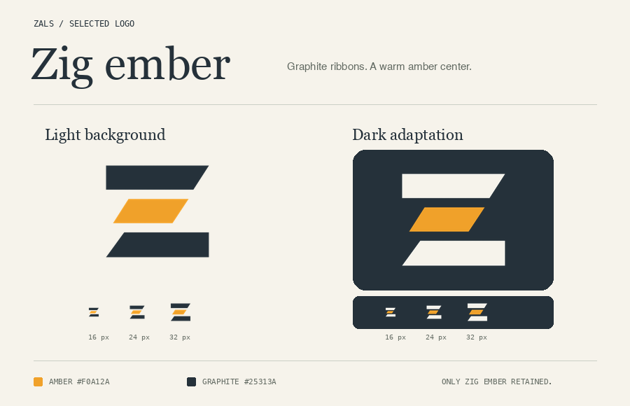

# zals — Zig ember

**Zig ember** is the selected logo: two graphite ribbons and a shorter amber
middle ribbon, with the deliberate indentation of YAML rhythm. All other
concepts and colorways have been removed.

[Open the preview](index.html) · [Download the logo](02-zig-ember.png)

## Palette

- **Amber:** `#F0A12A`
- **Graphite:** `#25313A`
- **Dark-background adaptation:** amber with off-white `#F6F3EB` outer ribbons.
  The geometry and transparency are unchanged.

## Assets

| File | Size | Purpose |
| --- | --- | --- |
| [Main logo](02-zig-ember.png) | 1024 × 1024 | Transparent PNG |
| [256 px](sizes/256/02-zig-ember.png) | 256 × 256 | General-purpose icon |
| [32 px](sizes/32/02-zig-ember.png) | 32 × 32 | Small icon |
| [24 px](sizes/24/02-zig-ember.png) | 24 × 24 | Small icon |
| [16 px](sizes/16/02-zig-ember.png) | 16 × 16 | Tiny icon |
| [Dark adaptation](dark/02-zig-ember.png) | 256 × 256 | Transparent PNG for dark backgrounds |
| [Model output](originals/02-zig-ember.png) | 1024 × 1024 | Untouched black/amber-on-white generation |
| [Preview sheet](overview.png) | 900 × 580 | Light/dark presentation with actual 16/24/32 px samples |

View the preview sheet at 100% zoom to judge the actual icon sizes accurately.
The preview backgrounds are not part of the transparent logo assets.

## Provenance

The selected mark was generated by **OpenAI GPT Image 2** through Azure OpenAI's
Image Edits API, using the earlier YAML rhythm study as its visual reference.
Requests used `quality: medium`, `size: 1024x1024`, and PNG output.

The [provenance file](prompts.json) contains only the selected logo's prompt,
palettes, generation parameters, and API-reported usage. The discarded input
reference is no longer retained. No credentials or private endpoint are stored.

Postprocessing removed the white background, corrected the palette, centered
the mark, and exported smaller PNGs. **The selected logo files are unchanged
from the chosen colorway.** These are raster assets, not SVG/vector masters.
